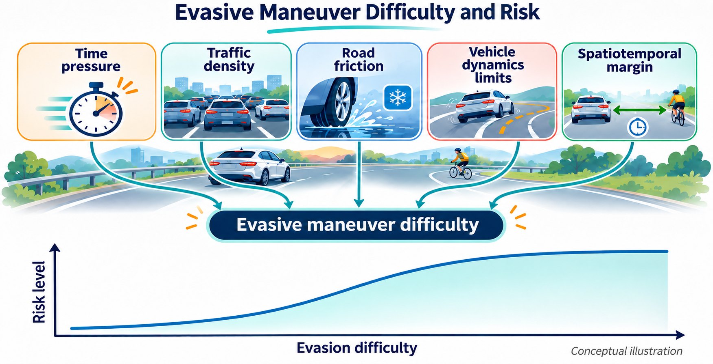
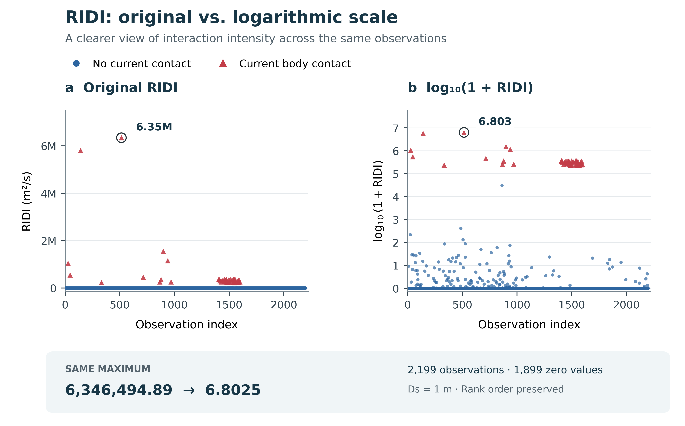

# Can You Get RID of Risk?

Think you can **get RID of risk** in traffic? A gentle tap on the brake, a little extra room, and you are out of trouble. Smooth braking, no drama. Then traffic changes the script.

Many classic safety metrics keep an eye on **“how close”** or **“how soon.”** Yet two encounters can earn the same score while demanding very different responses: one is a calm, controlled slowdown; the other is a last-second, white-knuckle scramble for space. That is the **identity paradox** in everyday terms: **the metric stays chill while the driving task turns nasty.** Same score. Very different story behind the wheel.

**RID (Relative Interaction Domain)** brings the driving task into the picture: the **space an evasive manoeuvre needs** and the **time the encounter leaves**. By combining vehicle geometry, relative motion, and braking-based spatial demand, it gives those deceptively similar encounters a more revealing description.

So, can you **get RID of trouble before trouble gets you?** That is the question behind this project.

## About the paper

This repository provides the implementation accompanying our paper, published in **Transportation Research Part C: Emerging Technologies (TRC)**:

> **Relative interaction Domain (RID): a real-time two--dimensional risk quantification model considering anticipated spatial demand**

The standalone implementation constructs vehicle interaction domains from physical footprints, relative motion, a safety buffer, and braking-based spatial demand. It combines their interaction areas with the anticipated event time, **TANT**, to calculate **RCDI, REDI, and RIDI**.

## What the implementation provides

- **Two-dimensional vehicle geometry.** Oriented rectangular bodies represent vehicle dimensions and headings; relative velocity determines the direction of motion.
- **Braking-based spatial demand.** A configurable deceleration magnitude determines the braking-distance contribution to the domain's longitudinal extent.
- **Anticipated events.** Continuous geometry identifies the first predicted physical contact or the earliest attainment of the minimum future body clearance.
- **Three interaction intensities.** RCDI, REDI, and RIDI describe distinct combinations of physical and buffered interaction areas, normalized by TANT.
- **Six event classes.** Interaction, Friction, Critical Conflict, Collision, Safe, and Detachment, with a configurable time threshold.
- **A standalone Python interface.** Use a single state pair, a pandas DataFrame, or a CSV file. CSV processing supports multiple worker processes.

The implementation is contained in [`rid_model.py`](rid_model.py), with English documentation and usage examples.

## Outputs

Each input row represents one ordered vehicle pair at one synchronized time. Vehicle **A / i** is the reference agent; vehicle **B / j** is the counterpart.

| Output | Meaning | Unit |
|---|---|---|
| `RCDI` | Cropped RCD domain intersected with B's physical projection band, divided by the regularized TANT | m²/s |
| `REDI` | Cropped RID domain intersected with B's physical projection band, divided by the regularized TANT | m²/s |
| `RIDI` | Cropped RID domain intersected with B's safety-buffered projection band, divided by the regularized TANT | m²/s |
| `T_ant` | Anticipated time to the selected collision or qualifying close-pass event | s |
| `rcd_area_m2`, `red_area_m2`, `rid_area_m2` | The three interaction areas before time normalization | m² |
| `current_clearance_m` | Current minimum distance between the physical vehicle bodies | m |
| `minimum_future_clearance_m` | Minimum predicted physical body clearance under the motion model | m |
| `event_distance_m` | Relative translation required to reach the selected event geometry | m |
| `conflict_level` | One of the six event classes defined below | — |
| `conflict_time_threshold_s` | Time threshold used for event classification | s |
| `event_status` | Geometric diagnostic, such as `future_collision`, `future_close_pass`, or `no_future_approach` | — |
| `radius_y_m` | Shared longitudinal semi-axis of RCD and RID | m |

Additional diagnostics include the domain radii, relative speed, projected relative acceleration, and current-contact flag. Full field definitions are available in `RIDResult` and the module documentation.

The indicators have the geometric ordering **RCDI ≤ REDI ≤ RIDI**, up to numerical roundoff. They are directed quantities: swapping A and B can change the domain geometry and the resulting areas. Their values describe interaction intensity; they are not calibrated collision probabilities.

## Interaction domains and event classes

**RCD and RID have the same longitudinal extent in the relative coordinate system.** Their longitudinal semi-axis is shared:

```text
R_RCD,y = R_RID,y = R_y
```

The domains differ in transverse width: RCD uses the projected physical half-width of vehicle A, while RID adds `Ds` to each side. Both use the same longitudinal crop when calculating the interaction areas. The three indices are the **Relative Interaction Domain Index (RIDI)**, **Relative Encroachment Domain Index (REDI)**, and **Relative Conflict Domain Index (RCDI)**.

For Interaction, Friction, and Critical Conflict, classification follows **(C1 OR C2) AND C3**. C1 means `T_ant < conflict_time_threshold_s`; C2 describes a current domain intersection; C3 requires the corresponding indices to be positive.

| `conflict_level` | Current intersection condition (C2) | Required positive indices (C3) |
|---|---|---|
| `Interaction` | B's safety-buffered body intersects A's RID | RIDI |
| `Friction` | B's physical body intersects A's RID | RIDI and REDI |
| `Critical Conflict` | B's physical body intersects A's RCD | RIDI, REDI, and RCDI |

These intersection conditions use the full domains; area normalization uses their cropped portions. An index must remain positive even when C2 is satisfied. When several classes qualify, **Critical Conflict takes priority over Friction, then Interaction**.

The remaining classes are:

- **Collision:** the physical bodies currently touch or overlap; this takes priority over every other class.
- **Detachment:** a separated pair with nonzero relative speed has already attained its minimum future clearance at the current instant, so no later approach event is selected. This includes separating motion and an already attained flat minimum.
- **Safe:** none of the above conditions applies. A separated pair with effectively zero relative speed also receives this class.

The default time threshold is **3 s**. The timing condition is strict: equality alone does not trigger a conflict class, although a qualifying current intersection can still do so. A predicted future collision does not by itself receive the `Collision` class; that label describes current physical contact. For a separated pair with no qualifying future event, `T_ant = inf` and the three indices are zero.

## Installation and quick start

The module supports **Python 3.8 or later** and requires NumPy and Shapely:

```bash
python -m pip install numpy shapely
```

Download `rid_model.py`, or clone this repository:

```bash
git clone https://github.com/LiQi12/Can-you-get-RID-off-.git
cd Can-you-get-RID-off-
python rid_model.py --demo
```

The demonstration uses a 4 m × 2 m vehicle travelling at 5 m/s toward an equally sized stationary vehicle whose centre is 20 m ahead. The expected output is approximately:

```text
RCDI: 4.654519
REDI: 4.677758
RIDI: 9.309038
T_ant: 3.2
conflict_level: Safe
```

### Python API

```python
from rid_model import AgentState, RIDConfig, compute_rid_metrics

ego = AgentState(
    x=0, y=0, vx=5, vy=0,
    heading=0, length=4, width=2,
)
other = AgentState(
    x=20, y=0, vx=0, vy=0,
    heading=0, length=4, width=2,
)

config = RIDConfig(Ds=1.0, acr=1.67, conflict_time_threshold_s=3.0)
result = compute_rid_metrics(ego, other, config)

print(result.rcdi, result.redi, result.ridi, result.tant_s, result.conflict_level)
print(result.to_dict())
```

Named-field dictionaries are also accepted by `compute_rid_metrics`. The `tant_s` attribute is exported as `T_ant` by `to_dict()` and the CSV interface.

## Parameters and safety-boundary selection

| Parameter | Default / suggested setting | Role |
|---|---:|---|
| `Ds` | **1.0 m**: motor-vehicle calibration and code default; **2.0 m**: conservative setting for complex traffic | Outward safety-buffer distance, additional RID half-width, and upper clearance threshold for a non-collision event |
| `acr` | **1.67 m/s²** | Positive braking-deceleration magnitude used in `v² / (2 × acr)` for both vehicles |
| `conflict_time_threshold_s` | **3.0 s** | Strict time threshold for conflict classification; does not change the indicator values |
| `domain_exponent` | 20 | Superellipse shape parameter |
| `anticipation_dt_s` | 0.2 s | Interval used in the local acceleration correction to relative speed |
| `superellipse_points` | 100 | Number of vertices used to approximate each superellipse |
| `time_epsilon_s` | 0.000001 s | Minimum denominator used when normalizing areas by TANT |

**Choosing `Ds`.** Calibration using motor-vehicle data yielded **1 m**. This value can be suitable for low-speed interactions, but may provide too little safety margin at higher speeds. For complex traffic conditions, **2 m is recommended as a conservative safety boundary** for proactive safety assessment or the assessment of spatiotemporal interaction intensity.

**Effect on the indices.** Changing `Ds` leaves the physical RCD geometry and **RCDI unchanged**, while it affects **REDI and RIDI** through the width of RID and the safety-buffered interaction band. A larger `Ds` also admits more non-collision close-pass events under the clearance condition below, allowing a more conservative assessment of surrounding interactions.

The code defaults to `Ds=1.0`. Select the conservative setting explicitly:

```python
config = RIDConfig(Ds=2.0, acr=1.67, conflict_time_threshold_s=3.0)
```

**Ds is measured outward from each side of the physical footprint.** A 2 m buffer therefore adds 4 m to the total transverse width; a 1 m buffer adds 2 m. Physical collision detection uses the unbuffered bodies.

For a non-collision path, a future event is eligible only when its minimum body clearance satisfies:

```text
0 < minimum_future_clearance < Ds
```

A minimum exactly equal to Ds is excluded. If no qualifying future approach exists, `T_ant` is infinite and all three intensities are zero. A collision path remains eligible independently of this non-collision clearance condition.

**Users may calibrate `acr` from their own trajectory data for different interaction angles and speed conditions.**

## Paired trajectory data

Each row must contain two vehicle states from the **same recording, location, and timestamp**. The module evaluates existing pairs; trajectory matching and synchronization take place before calculation. Keep recording and intersection identifiers when assembling data from multiple locations.

The following fields are required for **both** suffixes, `_i` and `_j`:

| Fields | Description | Unit |
|---|---|---|
| `x`, `y` | Global coordinates of the physical body centre | m |
| `vx`, `vy` | Global velocity components | m/s |
| `heading` | Body heading, counterclockwise from global +x | rad |
| `length`, `width` | Positive physical body dimensions | m |

For example, use `x_i` and `x_j` for the two x coordinates. The original `psi_kf_i` and `psi_kf_j` heading columns are also supported.

Optional acceleration fields are:

| Fields | Convention |
|---|---|
| `ax`, `ay` | Global acceleration components; provide both together. These take precedence when supplied. |
| `lon_acc`, `lat_acc` | Body-frame acceleration, with longitudinal acceleration positive forward and lateral acceleration positive **right**. |

All accelerations use m/s². Missing accelerations default to zero. If a dataset uses left-positive lateral acceleration, convert its sign or provide global `ax` and `ay` directly.

Metadata such as `source_file`, `frame_id`, `time`, `track_id_i`, `track_id_j`, `pair_id`, and `intersection_id` is preserved in the CSV and DataFrame outputs. Precomputed relative-coordinate fields are not required.

### CSV processing

A minimal `pairs.csv` can contain:

```csv
frame_id,intersection_id,track_id_i,track_id_j,x_i,y_i,vx_i,vy_i,heading_i,length_i,width_i,x_j,y_j,vx_j,vy_j,heading_j,length_j,width_j
0,example,1,2,0,0,5,0,0,4,2,20,0,0,0,0,4,2
```

Calculate the metrics using four worker processes:

```bash
python rid_model.py --input pairs.csv --output metrics.csv --workers 4
```

Parameters can be set explicitly:

```bash
python rid_model.py --input pairs.csv --output metrics_custom.csv --ds 1.0 --acr 1.67 --conflict-time-threshold 3.0
```

Choose a new output filename for each run. The CLI refuses to overwrite an existing file or append duplicate result columns to an input that already contains them.

### DataFrame processing

Install pandas if you want to use the DataFrame interface:

```bash
python -m pip install pandas
```

```python
import pandas as pd
from rid_model import RIDConfig, compute_rid_dataframe

pairs = pd.read_csv("pairs.csv", float_precision="round_trip")
metrics = compute_rid_dataframe(pairs, RIDConfig(Ds=1.0, acr=1.67))
print(metrics[["RCDI", "REDI", "RIDI", "T_ant", "conflict_level"]])
```

The output retains the input index and identity columns. For an individual paired row, use `compute_rid_from_row(row, config)`.

## Model assumptions and future improvements

The current model assumes fixed body headings and linear relative translation. TANT applies a local acceleration correction to relative speed; it does not predict a complete turning or braking-to-rest trajectory. These assumptions limit its representation of interactions along curved roads and during turning manoeuvres.

The outputs describe instantaneous, directed interactions between two vehicles. Vehicle-level aggregation over neighbours and TE/TI risk-exposure calculations require a separate analysis step. Numerical conventions, including time regularization at current contact, are documented in `rid_model.py`.

We plan to incorporate **map-based prediction of feasible paths**, particularly on curves and during turning manoeuvres, to refine the identification of approaching interactions and the associated **spatial demand for braking**. This development aims to improve the accuracy of risk identification and provide a stronger modelling foundation for risk assessment and injury prevention in automated driving.

## Displaying RIDI on a logarithmic scale

RIDI can become very large when the anticipated event time is close to zero. For visualization, use **`log10(1 + RIDI)`** to compress its dynamic range and make lower and moderate values easier to distinguish alongside large values.



**Original and transformed RIDI.** Both panels show the same 2,200 paired vehicle states (`Ds = 1 m`), including 1,899 zeros. The maximum changes from 6,346,494.89 to 6.8025 on the displayed coordinate, while the ordering is preserved. Orange triangles mark current body contact according to the model; large contact values depend on the numerical time floor. `M` denotes one million; the horizontal axis is observation order, not time.

Use RIDI values expressed consistently in **m²/s**. Formally, the dimensionless plotting coordinate is `log10(1 + RIDI / R_ref)`, with `R_ref = 1 m²/s`; this gives the same numerical result as the shorthand above for the module's outputs.

```python
import numpy as np

metrics["RIDI_log10"] = np.log10(1.0 + metrics["RIDI"])
```

Plot `RIDI_log10` on a linear axis labelled `log10(1 + RIDI)`. The values have already been transformed, so an additional logarithmic axis is unnecessary.

| Raw RIDI (m²/s) | `log10(1 + RIDI)` |
|---:|---:|
| 0 | 0 |
| 9 | 1 |
| 99 | 2 |
| 999 | 3 |
| 9,999 | 4 |

Adding 1 keeps zero values defined and maps them to zero. The transformation is strictly increasing, so it preserves the ordering of RIDI values. Each increase of one in the plotted coordinate represents a tenfold increase in `1 + RIDI`, rather than an equal increase in raw RIDI.

This is a display transformation: it compresses large finite values without clipping them, and it does not impose an upper bound or turn infinity into a finite value. Retain raw RIDI for physical interpretation and exposure calculations; integrating the transformed values would define a different quantity. A raw threshold `c` corresponds to `log10(1 + c)` on the transformed coordinate when the same units are used.

## License

This repository is distributed under the [MIT License](LICENSE).
