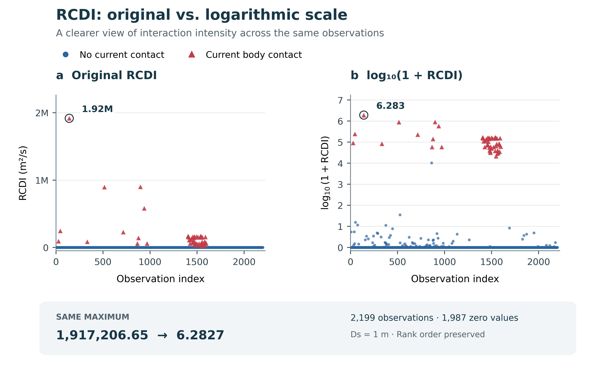

# Can You Get RID of Risk?

Can you really **get RID of risk** in traffic? Sometimes, a gentle touch of the brakes is all it takes. Other times, you brake hard and wish you had a little more road to work with.

Many familiar safety metrics tell us **how close** vehicles are or **how soon** they might collide. Yet the same score can describe an easy slowdown or a difficult evasive maneuver. This is the **identity paradox**: **the numbers look the same, but life behind the wheel feels very different.**

**RID (Relative Interaction Domain)** focuses on **the space needed to avoid a collision and the time available to act**. It combines vehicle geometry, relative motion, and braking demand to capture differences that distance or timing alone can miss.

So, can you **get RID of trouble before trouble gets you?** That is the question behind this project.

## About the paper

This repository accompanies our paper in **Transportation Research Part C: Emerging Technologies (TRC)**:

> **Relative interaction Domain (RID): a real-time two--dimensional risk quantification model considering anticipated spatial demand**

RID combines vehicle geometry, relative motion, and braking-based spatial demand to quantify traffic interactions through **RCDI, REDI, and RIDI**.

## What the implementation provides

- **Vehicle interaction domains** built from oriented vehicle footprints, relative velocity, and braking demand.
- **Anticipated event time (TANT)** for physical contact or a close pass within the selected safety boundary.
- **Three interaction indices and six event classes:** Interaction, Friction, Critical Conflict, Collision, Safe, and Detachment.
- **A single Python module**, [`rid_model.py`](rid_model.py), supporting state pairs, pandas DataFrames, and CSV files with parallel processing.

## Outputs

Each result describes one ordered vehicle pair at a synchronized instant. **A / i** is the reference vehicle and **B / j** is the counterpart.

| Output | Meaning | Unit |
|---|---|---|
| `RCDI` | Interaction intensity from the cropped RCD and B's physical projection band | m²/s |
| `REDI` | Interaction intensity from the cropped RID and B's physical projection band | m²/s |
| `RIDI` | Interaction intensity from the cropped RID and B's safety-buffered projection band | m²/s |
| `T_ant` | Anticipated time to physical contact or a qualifying close pass | s |
| `conflict_level` | One of the six event classes below | — |
| `event_status` | Event geometry, such as `future_collision`, `future_close_pass`, or `no_future_approach` | — |
| `radius_y_m` | Shared longitudinal semi-axis of RCD and RID | m |

Each index equals its interaction area divided by `max(T_ant, time_epsilon_s)`. The results also include the three areas, current and anticipated clearances, event distance, and relative-motion quantities; see `RIDResult` for the complete output fields.

The indices follow **RCDI ≤ REDI ≤ RIDI**. They describe directed interactions: choosing a different reference vehicle can change the domain geometry and resulting values.

## Interaction domains and event classes

**RCD and RID share the same longitudinal semi-axis** in the relative coordinate system:

```text
R_RCD,y = R_RID,y = R_y
```

RCD uses A's projected physical half-width; RID adds `Ds` on each side. Both domains use the same longitudinal crop for the area calculations. Their associated indices are the **Relative Interaction Domain Index (RIDI)**, **Relative Encroachment Domain Index (REDI)**, and **Relative Conflict Domain Index (RCDI)**.

Interaction, Friction, and Critical Conflict follow **(C1 OR C2) AND C3**:

- **C1:** `T_ant < conflict_time_threshold_s`, with a default threshold of **3 s**.
- **C2:** a current intersection with the full interaction domain, as defined below.
- **C3:** positive values of the corresponding indices.

| Class | Current intersection (C2) | Positive indices (C3) |
|---|---|---|
| `Interaction` | B's safety-buffered body intersects A's RID | RIDI |
| `Friction` | B's physical body intersects A's RID | RIDI and REDI |
| `Critical Conflict` | B's physical body intersects A's RCD | RIDI, REDI, and RCDI |

The other classes describe the current encounter:

- **Collision:** the physical bodies touch or overlap.
- **Detachment:** the vehicles are separated and, while moving relative to one another, have reached or passed their closest approach.
- **Safe:** the pair meets none of the preceding event conditions, including separated vehicles with negligible relative speed.

The reported class follows this priority: **Collision → Detachment → Critical Conflict → Friction → Interaction → Safe**.

## Installation and quick start

Use **Python 3.8 or later** with NumPy and Shapely:

```bash
python -m pip install numpy shapely
```

Download `rid_model.py`, or clone the repository:

```bash
git clone https://github.com/LiQi12/Can-you-get-RID-off-.git
cd Can-you-get-RID-off-
python rid_model.py --demo
```

The example uses two 4 m × 2 m vehicles with their centres 20 m apart. A travels at 5 m/s toward stationary B, giving:

```text
RCDI: 4.654519
REDI: 4.677758
RIDI: 9.309038
T_ant: 3.2
conflict_level: Safe
```

### Python API

```python
from rid_model import AgentState, RIDConfig, compute_rid_metrics

ego = AgentState(
    x=0, y=0, vx=5, vy=0,
    heading=0, length=4, width=2,
)
other = AgentState(
    x=20, y=0, vx=0, vy=0,
    heading=0, length=4, width=2,
)

config = RIDConfig(Ds=1.0, acr=1.67, conflict_time_threshold_s=3.0)
result = compute_rid_metrics(ego, other, config)

print(result.rcdi, result.redi, result.ridi, result.tant_s, result.conflict_level)
print(result.to_dict())
```

`compute_rid_metrics` also accepts dictionaries with named fields. The `tant_s` attribute appears as `T_ant` in dictionary and CSV outputs.

## Parameters and safety-boundary selection

| Parameter | Default / suggested setting | Role |
|---|---|---|
| `Ds` | **1.0 m**: motor-vehicle calibration and code default; **2.0 m**: conservative setting for complex traffic | Safety-buffer distance, additional RID half-width, and clearance threshold for close-pass events |
| `acr` | **1.67 m/s²** | Braking-deceleration magnitude in `v² / (2 × acr)` for both vehicles |
| `conflict_time_threshold_s` | **3.0 s** | Time threshold for event classification |
| `domain_exponent` | 20 | Superellipse shape parameter |
| `anticipation_dt_s` | 0.2 s | Interval for the local acceleration correction |
| `superellipse_points` | 100 | Vertices used to represent each superellipse |
| `time_epsilon_s` | 0.000001 s | Minimum time denominator for the interaction indices |

Motor-vehicle calibration gives **Ds = 1 m**, a setting suited to low-speed interactions that may be aggressive at higher speeds. For complex traffic, **Ds = 2 m** provides a conservative safety boundary for proactive safety assessment and the evaluation of spatiotemporal interaction intensity.

`Ds` changes **REDI and RIDI** by widening RID and B's safety buffer; **RCDI remains unchanged**. It is measured outward from each side of the physical footprint, so a 2 m buffer adds 4 m to the total width. Select this setting with:

```python
config = RIDConfig(Ds=2.0, acr=1.67, conflict_time_threshold_s=3.0)
```

A future non-collision encounter receives a finite TANT when its minimum body clearance satisfies:

```text
0 < minimum_future_clearance < Ds
```

Without a qualifying future approach, `T_ant = inf` and the three indices are zero. Physical collision timing uses the unbuffered vehicle bodies.

**Users may calibrate `acr` from their own trajectory data for different interaction angles and speed conditions.**

## Paired trajectory data

Supply one row per vehicle pair, with both states drawn from the **same recording, location, and timestamp**. Match and synchronize the trajectories before running the module.

The following fields are required for both `_i` and `_j`:

| Fields | Description | Unit |
|---|---|---|
| `x`, `y` | Global coordinates of the physical body centre | m |
| `vx`, `vy` | Global velocity components | m/s |
| `heading` | Body heading, counterclockwise from global +x | rad |
| `length`, `width` | Physical body dimensions | m |

For example, `x_i` and `x_j` give the two x coordinates. Heading aliases `psi_kf_i` and `psi_kf_j` are also supported.

Optional acceleration fields use the same suffixes:

| Fields | Convention |
|---|---|
| `ax`, `ay` | Global components, supplied together; these take precedence when available |
| `lon_acc`, `lat_acc` | Body-frame components: longitudinal positive forward, lateral positive **right** |

All accelerations use m/s² and default to zero. For data with left-positive lateral acceleration, reverse its sign or supply global `ax` and `ay`.

Recording, intersection, trajectory identifiers, and other input metadata are preserved in the outputs.

### CSV processing

A minimal `pairs.csv` contains:

```csv
frame_id,intersection_id,track_id_i,track_id_j,x_i,y_i,vx_i,vy_i,heading_i,length_i,width_i,x_j,y_j,vx_j,vy_j,heading_j,length_j,width_j
0,example,1,2,0,0,5,0,0,4,2,20,0,0,0,0,4,2
```

Calculate the metrics with four worker processes:

```bash
python rid_model.py --input pairs.csv --output metrics.csv --workers 4
```

To set the parameters explicitly:

```bash
python rid_model.py --input pairs.csv --output metrics_custom.csv --ds 1.0 --acr 1.67 --conflict-time-threshold 3.0
```

Use a new output filename for each run.

### DataFrame processing

Install pandas:

```bash
python -m pip install pandas
```

```python
import pandas as pd
from rid_model import RIDConfig, compute_rid_dataframe

pairs = pd.read_csv("pairs.csv", float_precision="round_trip")
metrics = compute_rid_dataframe(pairs, RIDConfig(Ds=1.0, acr=1.67))
print(metrics[["RCDI", "REDI", "RIDI", "T_ant", "conflict_level"]])
```

The output retains the input index and metadata. Use `compute_rid_from_row(row, config)` for an individual paired row.

## Model assumptions and future improvements

The model represents vehicle motion with fixed body headings and linear relative translation. TANT incorporates a local acceleration correction to relative speed. Each result describes an instantaneous, directed interaction; vehicle-level exposure analysis combines these results across neighbouring vehicles and time.

Future development will incorporate **map-based prediction of feasible paths**, particularly on curves and during turning manoeuvres, to refine the identification of approaching interactions and the associated **spatial demand for braking**. This work aims to improve risk identification and strengthen the modelling foundation for risk assessment and injury prevention in automated driving.

## Displaying RIDI and RCDI on a logarithmic scale

When the anticipated event time is small, RIDI and RCDI can span several orders of magnitude. Plotting **`log10(1 + index)`** brings lower and moderate interaction values into view alongside the largest values.

### RIDI


### RCDI



Both figures use the same **2,199 paired vehicle states** at `Ds = 1 m`. Blue circles represent separated bodies; red triangles represent current body contact in the model. Within each figure, rings identify the same maximum on the original and transformed coordinates. The horizontal axis follows observation order, and `M` denotes one million.

With the indices expressed in **m²/s**, compute the plotting coordinates as:

```python
import numpy as np

for indicator in ("RIDI", "RCDI"):
    metrics[f"{indicator}_log10"] = np.log1p(metrics[indicator]) / np.log(10.0)
```

The coordinate is dimensionless: formally, it is `log10(1 + index / R_ref)` with `R_ref = 1 m²/s`. Plot the transformed values on a linear axis labelled `log10(1 + RIDI)` or `log10(1 + RCDI)`.

| Raw index (m²/s) | `log10(1 + index)` |
|---:|---:|
| 0 | 0 |
| 9 | 1 |
| 99 | 2 |
| 999 | 3 |
| 9,999 | 4 |

The transformation maps zero to zero and preserves the ordering of the index values. Each unit on the transformed coordinate corresponds to a tenfold increase in `1 + index`. Use the transformed values for visualization and the original values for physical interpretation and exposure calculations.

## License

This repository is distributed under the [MIT License](LICENSE).
